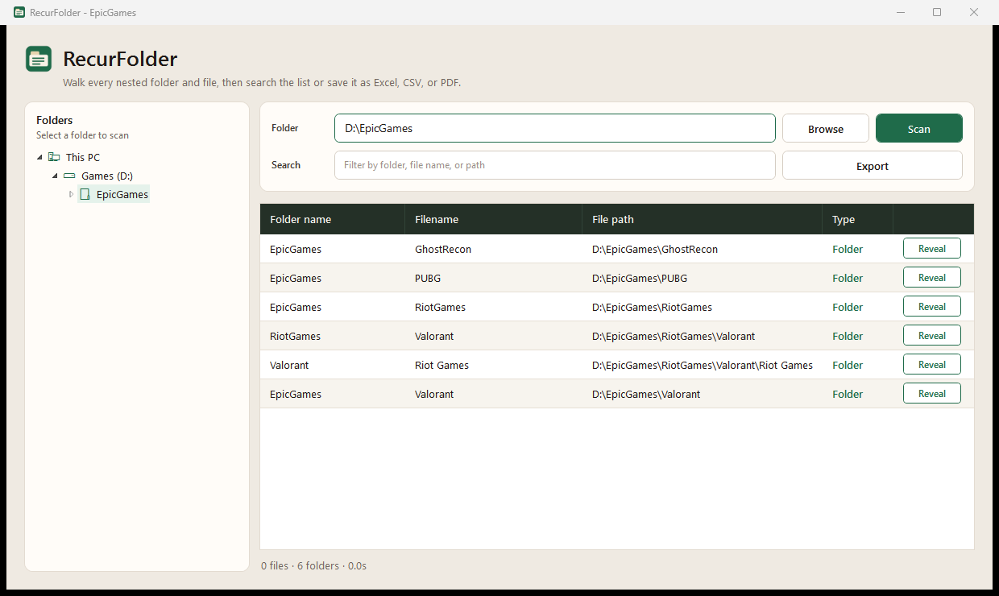
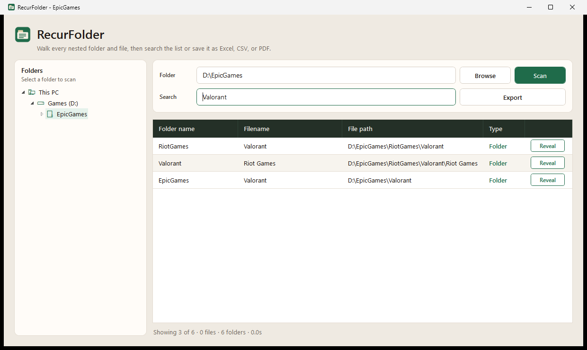
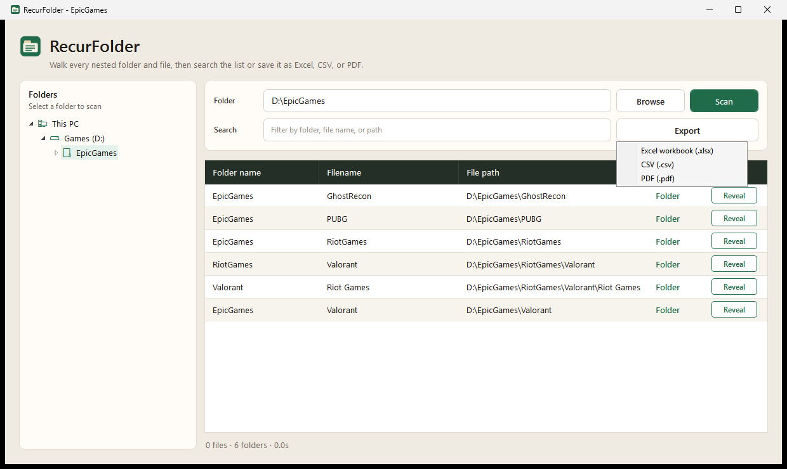

# RecurFolder

RecurFolder is a free, open-source Windows app that lists every file and folder under a directory you choose. You can search that list, open an item in File Explorer, and save it as Excel, CSV, or PDF.

Version 1.1. It is a Windows desktop app for 64-bit Windows 10 and Windows 11.

Maintained by Smilu Varghese.

## Screenshots

These pictures show a scan of `D:\EpicGames`. The folder tree shows only that branch.

### The list



### Search

Search keeps the rows that match. Here the word Valorant leaves three folders.



### Export

Export saves the rows on screen as Excel, CSV, or PDF.



## Download

Download the Windows setup from here: [RecurFolder-Setup.msi](https://github.com/smiluv/recurfolder/raw/master/setup/RecurFolder-Setup.msi)

Double-click the downloaded file. The setup does not ask for administrator rights. It installs for the current user and adds Start menu and desktop shortcuts. The .NET runtime is included.

## Purpose

Finding one file inside a deep tree, or making a record of what a folder contains, usually means clicking through folder after folder. RecurFolder walks the tree once and puts the result in a grid:

| Column | Meaning |
| --- | --- |
| Folder name | The folder that directly contains the item |
| Filename | The file or folder name |
| File path | The full path |
| Type | `File` or `Folder` |

Use it to review a project, a drive, or an archive, then keep a copy of the list.

## How it works

1. You choose a folder by typing a path, browsing, dropping a folder onto the window, clicking a folder in the tree, or passing a path on the command line.
2. RecurFolder walks that folder and every folder inside it. The walk is depth-first and does not follow junctions, symbolic links, or other reparse points, so a link cannot send the scan into a loop or off onto another tree. Those links are still listed as their own row.
3. Each file and folder becomes one row. Folders you cannot read are skipped and counted as inaccessible. The status line shows file count, folder count, skipped items, links that were not opened, and how long the scan took.
4. The grid shows the rows. Search filters them. Export writes the rows you can see, in the current sort order.
5. Reveal opens File Explorer with that file or folder selected.

The folder tree on the left starts at This PC and loads drives and subfolders as you expand them. Click a folder name, or select it and press Enter, to scan it. The expander only opens the branch. Hidden and system folders are hidden in the tree, and they are still included when you scan a parent folder. This PC itself is not a scan target.

Search is live and ignores letter case. Separate words with spaces. A row stays only when every word appears in its folder name, filename, path, or type.

Cancel stops a scan that is still running. The rows found so far stay in the grid.

## How to use it

### Install

Download [RecurFolder-Setup.msi](https://github.com/smiluv/recurfolder/raw/master/setup/RecurFolder-Setup.msi) and double-click it. The setup does not ask for administrator rights. It installs for the current user to:

`%LocalAppData%\Programs\RecurFolder`

It adds Start menu and desktop shortcuts. The installer includes the .NET runtime, so the other computer does not need .NET installed separately. Uninstall RecurFolder from Settings, under Apps.

If RecurFolder is already open, close it before you run the setup.

### Start a scan

- Type or paste a folder path and press **Scan**, or press Enter in the path box.
- Click **Browse** and pick a folder.
- Drop a folder onto the window. Dropping a file uses the folder that contains it.
- Click a folder in the left tree.
- Start the app with a folder path:

```text
RecurFolder.exe "D:\Projects"
```

Clicking a drive scans that whole drive. Use **Cancel** if the scan is larger than you wanted.

### Search, reveal, and export

- Type in **Search** to filter the grid. **Ctrl+F** moves to the search box.
- Double-click a row, press Enter, or click **Reveal** to show that item in File Explorer. You can also right-click a row to reveal it or copy its path.
- Click **Export**, then choose Excel (`.xlsx`), CSV (`.csv`), or PDF (`.pdf`). **Ctrl+E** opens the same menu. Export saves only the rows currently shown, so a search is included in the file. The suggested name is the folder name plus the date and time, and the dialog opens in Documents.

CSV is UTF-8, so names in other languages stay intact when Excel opens the file. A name that begins with `=`, `+`, `-`, or `@` is written as text, so Excel does not treat it as a formula. PDF is a landscape table with the same four columns, and long values are clipped to the column width.

## Build from source

You need the .NET 10 SDK on 64-bit Windows.

```text
dotnet build RecurFolder.csproj -c Release
```

The app is written to `bin\Release\net10.0-windows\RecurFolder.exe`. That copy needs the .NET 10 desktop runtime, which the SDK provides.

Rebuild the installer with:

```text
dotnet build installer\RecurFolder.Setup.wixproj -c Release
```

The setup file is written to `setup\RecurFolder-Setup.msi`. WiX is restored from NuGet while that project builds. The installer publishes a self-contained 64-bit app and packages it.

Main pieces:

| Path | Role |
| --- | --- |
| `MainWindow.xaml` | Window, folder tree, grid, and commands |
| `Services\FolderScanner.cs` | Recursive listing |
| `Services\ExcelExporter.cs` | Excel export (ClosedXML) |
| `Services\CsvExporter.cs` | CSV export |
| `Services\PdfExporter.cs` | PDF export (PDFsharp) |
| `installer\` | WiX setup project |

ClosedXML and PDFsharp are MIT-licensed libraries. Their license notices stay with those packages.

## Open source

RecurFolder is open source under the MIT License. The full text is in [LICENSE](LICENSE). You may use it, study it, change it, and share it, including inside a commercial product.

### What you may do

- Run the app for any purpose, personal or commercial.
- Copy and share the source code and the installer.
- Change the source and publish your changes.
- Include RecurFolder in a larger product.

### What you need to do

- Keep the copyright notice and the MIT License text with any copy or substantial portion of the software.
- If you distribute a modified version, include the license and make it clear that you changed it.
- License contributions you send to this project under the same MIT License. That lets everyone keep using, changing, and sharing them.

### What the license does not grant

- It does not give you the right to hold the authors liable for damage.
- It does not promise that the software is fit for a particular purpose.
- It does not transfer trademarks. The RecurFolder name stays with the project.
- It does not make you the owner of third-party libraries. ClosedXML, PDFsharp, and the WiX toolset keep their own licenses.

### Warranty

The software is provided as is, without warranty of any kind. Scanning a large drive can take time and will read every folder your account is allowed to open. RecurFolder lists files. It does not change, move, or delete them.

### Working on the project

- Keep each change focused on one thing.
- Match the style of the surrounding code.
- Do not commit secrets, passwords, or private file listings.
- Describe what you changed and how you checked it.
- Be respectful in issues and reviews. Disagree about the code, and leave people out of it.

Issues and improvements are welcome. A good report says what you did, what you expected, and what happened instead, including your Windows version.
